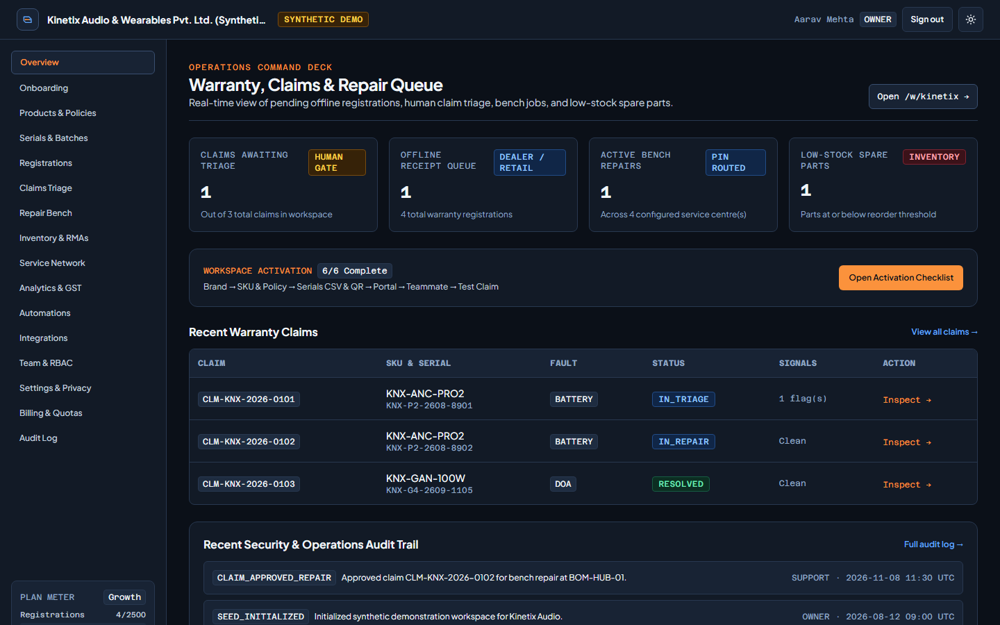
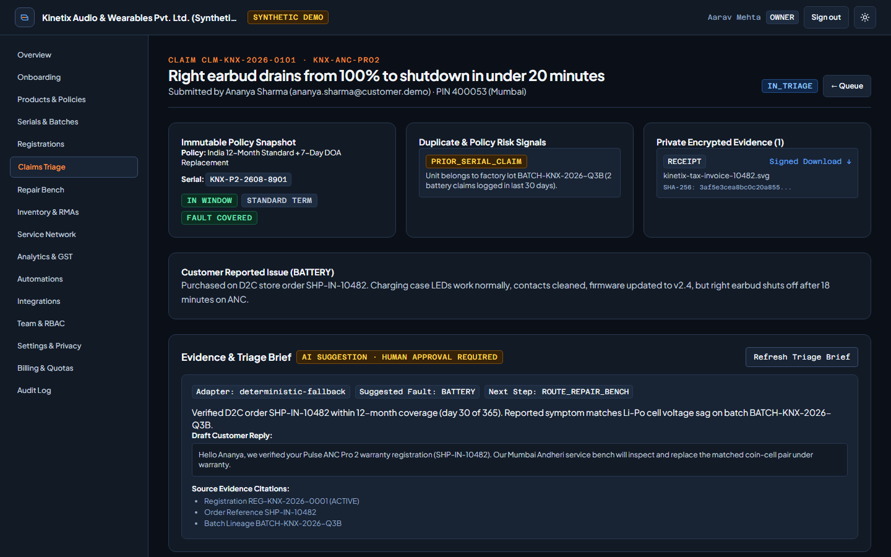
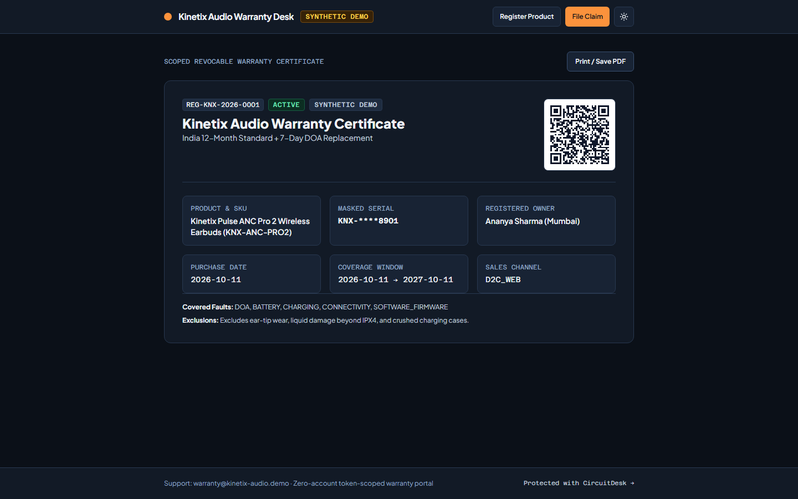
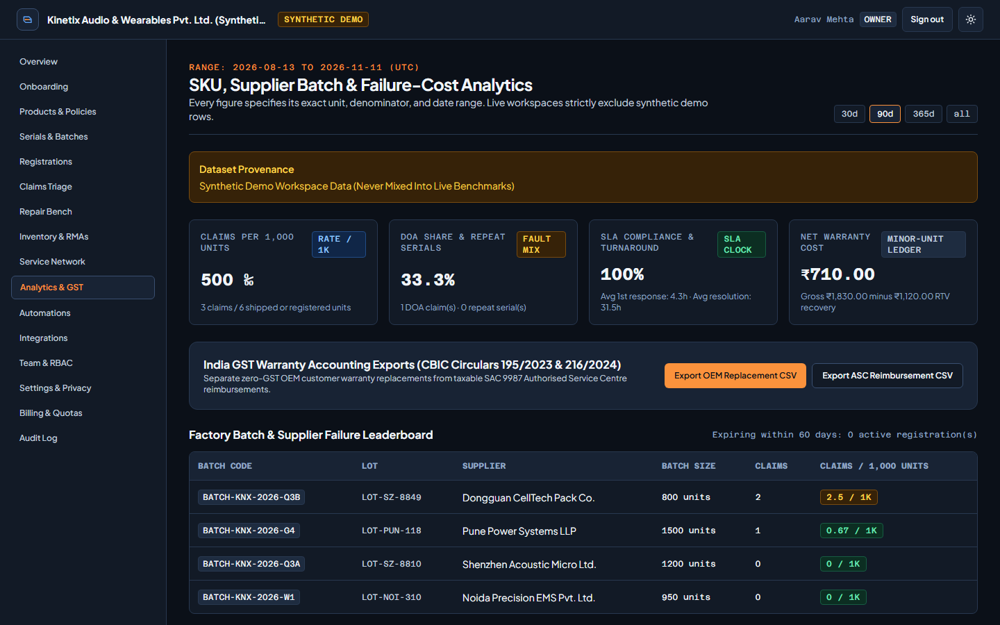

# CircuitDesk

Every product has an afterlife. Manage it beautifully. Multi-tenant warranty, returns, and repair operations platform for electronics, audio, wearable, charging, and appliance brands.

[](https://circuitdesk.vercel.app)
[](https://github.com/devtechedge/circuitdesk/actions/workflows/ci.yml)
[](https://nextjs.org/)
[](https://www.typescriptlang.org/)
[](https://orm.drizzle.team/)
[](LICENSE)

---

## Live Demo

**https://circuitdesk.vercel.app**

- Branded Customer & Dealer Portal: **https://circuitdesk.vercel.app/w/kinetix/register**
- Interactive Sandbox & PIN Router: **https://circuitdesk.vercel.app/demo**
- Health & Provider Probe: **https://circuitdesk.vercel.app/api/health**

> **Status:** Production deployment runs on **Managed Neon PostgreSQL** (`db: "postgres"`, 32 Drizzle tables, 27 PostgreSQL Row-Level Security policies) with AES-256-GCM encrypted private evidence blobs. Seeded `Kinetix Audio` records are synthetic demonstration fixtures (`DEMO_MODE=true`). Stripe and Razorpay operate in labelled **Non-Charging Demo Billing Mode** until live merchant keys are configured; email and Meta WhatsApp log to the audited **Dev Sink** until provider credentials are supplied; the optional AI triage panel runs its deterministic citation extractor unless `AI_API_KEY` is set; Shopify signed HMAC webhooks and order CSV sync are active while public Shopify App Store listing remains pending.

### Synthetic Demo Credentials (`DEMO_MODE=true`)

One-click role buttons are available on `/login` and `/demo`, or sign in manually with password `CircuitDesk-Demo-2026!`:

| RBAC Role | Email | Effective Surface |
| --- | --- | --- |
| `OWNER` | `ops@kinetix-audio.demo` | Full catalog, serials, triage, benches, analytics, GST exports, billing, DPDP erasure & recall gate |
| `SUPPORT` | `support@kinetix-audio.demo` | Offline receipt verification & human claim adjudication |
| `TECHNICIAN` | `tech@kinetix-audio.demo` | Scoped strictly to assigned Mumbai service bench (`BOM-HUB-01`) |
| `ANALYST` | `analyst@kinetix-audio.demo` | Masked serials, SKU/batch failure-cost analytics & CBIC GST CSV exports |
| `READ_ONLY` | `viewer@kinetix-audio.demo` | Masked serials & immutable audit trail (zero write access) |

---

## Screenshots

| Operations Command Deck | Human Claim Adjudication & Triage Brief |
| --- | --- |
|  |  |

| Printable Customer Warranty Certificate | SKU, Supplier Batch & GST Analytics |
| --- | --- |
|  |  |

---

## Features

- **Connected Hardware Lifecycle** - links `Sale -> Registration -> Warranty Policy -> Claim -> Bench Repair / RMA Replacement / Refund -> Accounting Closure`.
- **Serial, IMEI & Supplier Batch Registry** - CSV dry-run preview with row-level SKU, duplicate-serial, 15-digit IMEI, and formula-injection checks, plus printable offline SVG QR packaging sheets.
- **Granular Coverage Engine** - policies by SKU, region, and channel (`D2C_WEB`, `MARKETPLACE`, `AUTHORISED_DEALER`, `OFFLINE_RETAIL`), DOA windows, offline invoice review gates, and EU Directive 2024/1799 repair extensions.
- **Zero-Account Branded Portal (`/w/[brand]`)** - customer and stockist registration, claim intake, printable QR warranty certificates, and live repair trackers using random 256-bit SHA-256 hashed revocable tokens.
- **Human Triage & Encrypted Evidence** - 7-category hardware fault taxonomy, duplicate/velocity risk signals, AES-256-GCM encrypted photos/invoices served via expiring HMAC-signed URLs, and an optional evidence-citing triage assistant barred from auto-denying claims.
- **6-Digit PIN Service Routing & Bench QA** - routes repairs by Indian PIN prefix, category certification, and active bench load; enforces atomic spare-part stock decrements, 4-point QA gates, RMA Return-to-Vendor recovery, and E-Waste Rules 2022 manifest refs.
- **SKU / Batch Failure-Cost Analytics & India GST Exports** - claims per 1,000 units, rogue factory lot leaderboards, Owner-gated recall audiences, and CBIC Circular 195/07/2023-GST & 216/10/2024-GST CSV registers (zero-GST OEM replacements vs SAC 9987 ASC reimbursements).
- **Multi-Tenant Security & Billing** - PostgreSQL Row-Level Security, 7-role RBAC, scrypt sessions, CSRF origin guards, SHA-256 hashed `/api/v1` keys, and idempotent Stripe (USD) + Razorpay (INR) webhooks across Starter ($49 / INR 3,999), Growth ($129 / INR 9,999), Scale ($299 / INR 24,999), and Enterprise tiers.

---

## Tech Stack

| Layer | Technology |
| --- | --- |
| Framework | Next.js 16.4 (App Router), React 19.3, strict TypeScript 5.9 |
| Styling | Tailwind CSS 4, industrial-modern design tokens, self-hosted Plus Jakarta Sans + Azeret Mono |
| Database | Managed Neon PostgreSQL in production (`pg` Pool + Drizzle ORM 0.45); embedded PGLite zero-config fallback when `DATABASE_URL` is unset locally |
| Security | Scrypt password hashing, HttpOnly SameSite cookies, PostgreSQL RLS, AES-256-GCM vault, Zod 4 |
| Testing | Vitest 5 (unit + PostgreSQL integration), Playwright 1.65 + `@axe-core/playwright` (WCAG 2.2 AA) |
| Hosting & CI | Vercel (git auto-deploy) + GitHub Actions (`postgres:17` service container) |

---

## Quick Start

Requires Node.js 22+ and `pnpm`.

```bash
git clone https://github.com/devtechedge/circuitdesk.git
cd circuitdesk
pnpm install
cp .env.example .env
pnpm dev
```

Open **http://localhost:3000**. When `DATABASE_URL` is left blank in `.env`, CircuitDesk automatically boots an embedded PostgreSQL (`PGLite`) instance and seeds the synthetic `Kinetix Audio` workspace.

To run against a dedicated PostgreSQL 17 or Neon database:

```bash
# Set DATABASE_URL and DATABASE_URL_UNPOOLED in .env
pnpm db:migrate
pnpm db:seed:demo
pnpm dev
```

### Verification Commands

```bash
pnpm lint               # ESLint 9 flat config (zero warnings/errors)
pnpm typecheck          # next typegen && tsc --noEmit (strict)
pnpm test               # Unit tests: money, GST, policies, PIN router, CSV, MRR, copy hygiene
pnpm test:integration   # PostgreSQL integration: RLS, IDOR denial, 7-role RBAC, lifecycle, webhooks, DPDP
pnpm build              # Production Next.js build
pnpm e2e                # Playwright Chromium journeys, 390/768/1440 overflow & axe WCAG 2.2 AA
```

---

## Environment Variables

`.env.example` contains safe placeholders only. Key variables:

- `DATABASE_URL` / `DATABASE_URL_UNPOOLED` - pooled runtime and direct migration PostgreSQL URLs.
- `APP_URL` - public origin (`https://circuitdesk.vercel.app` in production).
- `AUTH_SECRET`, `ENCRYPTION_KEY` (64 hex chars), `FILE_SIGNING_SECRET`, `WEBHOOK_SIGNING_SECRET` - required non-default secrets in hosted production.
- `DEMO_MODE` - `"true"` enables synthetic demo personas and badges; set `"false"` for private commercial deployments.
- Optional live provider credentials: `STRIPE_*`, `RAZORPAY_*`, `SHOPIFY_*`, `WOOCOMMERCE_*`, `RESEND_API_KEY`, `WHATSAPP_*`, `AI_API_KEY`.

Threat model and residual demo-mode risks are documented in [SECURITY.md](SECURITY.md).

---

## License

MIT. See [LICENSE](LICENSE).
